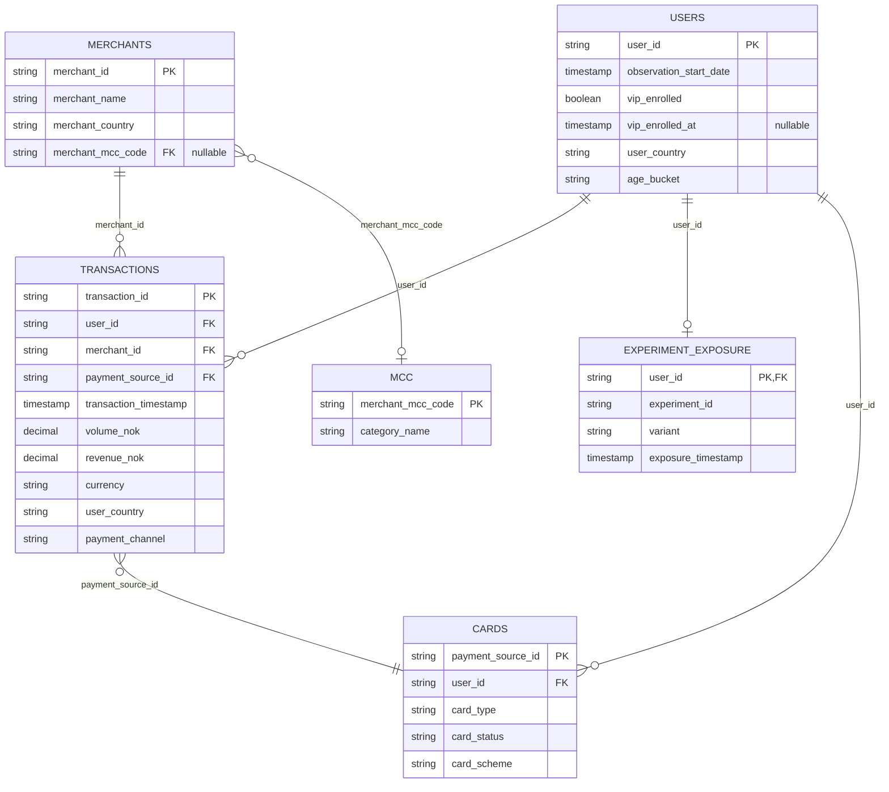

# Vipps Case Data Model

Entity-relationship diagram for the Vipps Data Analyst interview case. The
machine-readable definitions are in [`model.yml`](model.yml); full column
descriptions are in [`data/README.md`](../data/README.md).

## Legend

- `||--o{` — one to zero-or-more
- `||--o|` — one to zero-or-one
- `}o--||` — zero-or-more to one
- `}o--o|` — zero-or-more to zero-or-one
- `PK` — primary key
- `FK` — foreign key

## Notes

- `transactions` is the fact table; it has one row per completed purchase.
- `users`, `merchants`, `cards`, and `mcc` are dimension tables.
- `experiment_exposure` is a subset of users in the VIP invitation experiment.
- `merchants.merchant_mcc_code` is nullable; missing MCC means unclassified.
- `users.vip_enrolled_at` is nullable; missing means not enrolled at cutoff.
- `cards` is optional for analysis.
- `experiment_exposure.user_id` is both a primary key and a foreign key to
  `users.user_id`.
- Relationships are oriented from whichever side keeps the fact table central;
  the crow's-foot markers preserve the original cardinality.
