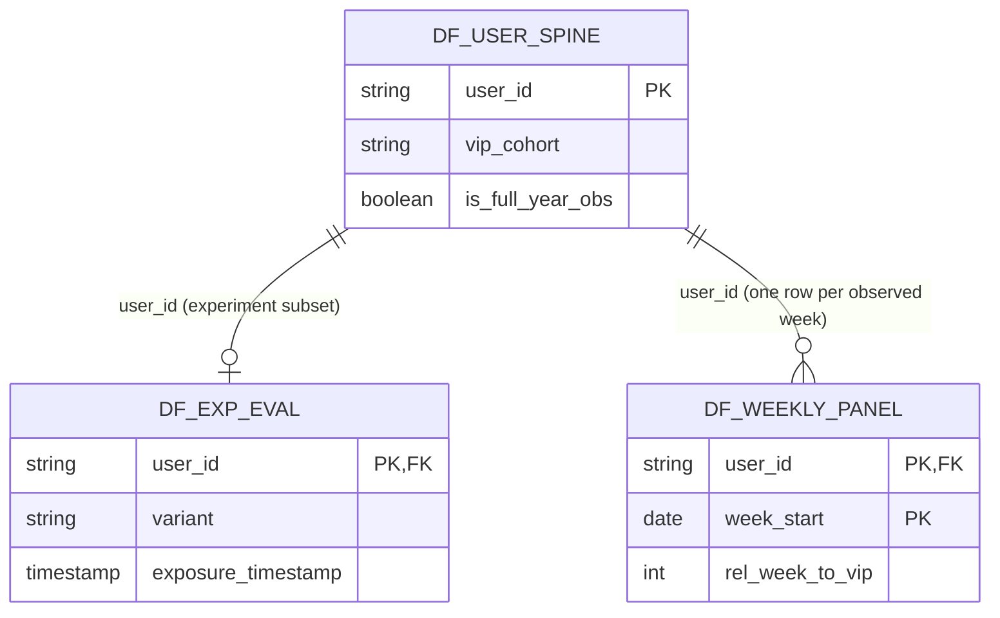

# Analytical Mart Model

Entity-relationship view of the three analysis-ready marts. Full column
semantics and calculations are in [`marts.yml`](marts.yml).

## Grain

- `df_user_spine`: one row per `user_id`.
- `df_exp_eval`: one row per experiment `user_id`; a subset of the user spine.
- `df_weekly_panel`: one row per `user_id` × `week_start`.

## Notes

- `df_exp_eval` is an experiment-level mart and is not joined back to the
  weekly panel for the VIP event study.
- `df_weekly_panel.rel_week_to_vip` is null for non-VIP users; week 0 is the
  Monday containing `vip_enrolled_at`.
- `df_user_spine` retains users with late coverage. Use `is_full_year_obs` for
  full-year comparisons.
